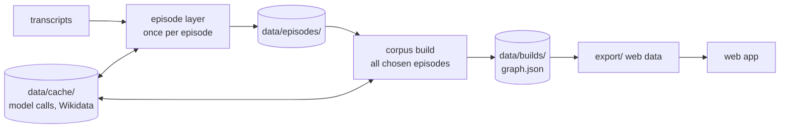

# Architecture

The goal is to connect what a podcast archive talks about across episodes, so a listener can
move from a person, work or concept to every passage where it comes up, and from any
connection back to the transcript and audio behind it. This file explains how the pipeline
and the web app are put together. Setup and commands are in [DEVELOPMENT.md](DEVELOPMENT.md).

## Overview

The pipeline works from the bottom up, in two layers.



**The episode layer** does everything that only needs one transcript: passages, mentions,
the entities of the episode, pronoun links, relations and their check against the
transcript. Each episode has its own folder, and nothing in it depends on other episodes.

**The corpus build** joins the episodes: it merges the same person, work or concept across
episodes, links them to Wikidata, finds related passages in other episodes, adds lifespans
and portraits, and writes the data for the app.

One command does both:

```sh
spoken-record update --corpus config/hop.json --episodes "HoP 230-254"
```

An episode folder is only rebuilt when its transcript or the settings it depends on change,
and model calls and Wikidata answers are cached. So adding a new episode runs the models on
that episode only, and a rebuild of unchanged episodes takes seconds.

## Levels

| Level | What it is | Where |
|---|---|---|
| passage | a few sentences, an exact slice of the transcript with start and end time | episode folder |
| mention | a typed name in a passage ("Aquinas", Person) | episode folder |
| episode entity | all names and pronouns of one thing in one episode ("Thomas Aquinas", "Aquinas", "he") | episode folder |
| corpus entity | the same thing across all episodes, with its Wikidata item | build |

Relations follow the same path. GLiREL proposes them between episode entities, the NLI model
decides each one against its transcript context, and the build lifts them to corpus entities
and combines the evidence of all episodes.

## The episode layer

`episodes.py` brings each chosen episode folder up to date, part by part.

| Part | Model | Files |
|---|---|---|
| source | | `episode.json`, `transcript.json`, `segments.jsonl` |
| passages | | `passages.jsonl` |
| mentions | GLiNER | `candidates.jsonl` (everything above the floor), `mentions.jsonl` (accepted) |
| coreference | FCoref | `coreference_clusters.json` (clusters as character spans) |
| graph | GLiREL, NLI | `episode_entities.jsonl`, `entities.jsonl`, `assignments.jsonl`, `coreference_links.jsonl`, `relation_contexts.jsonl`, `relation_candidates.jsonl`, `relation_assertions.jsonl`, `verification_evidence.jsonl`, `verification_decisions.jsonl` |
| embeddings | MPNet | `passage_embeddings.jsonl` |

`manifest.json` stores for every part the key it was made with and the hash of its files. The
key holds everything the part depends on, for example the transcript version, the GLiNER
settings and the model revision for the mentions. A part whose key matches is skipped. The
model parts are keyed by the transcript version, so a corrected title only rereads the
metadata, and changing the GLiREL settings only redoes the graph part.

In the graph part, mentions are grouped into the entities of the episode. First, mentions
that are only a pronoun or a similar word ("I", "you", "she", "someone") are dropped:
GLiNER scores spans against the label "person" and has no idea of a *name*, so it tags such
words often, mostly in interviews. The list is `not_names` in `config/resolution.json`.
Pronouns are left to FCoref, which links them to a named person or abstains. Same names merge,
and so do name variants of a person ("Thomas Aquinas" and later "Aquinas"), with the
settings in `config/identity_refinement.within-episode.json`. A short name that fits two
different people ("Bacon" next to Roger Bacon and Francis Bacon) merges with neither. A
pronoun is linked when the named mentions of its FCoref cluster belong to one person of the
episode. GLiREL then sees each sentence with its endpoints, and for a pronoun the earlier
sentences back to its antecedent, so "His most famous work, the Summa Theologiae" becomes
Thomas Aquinas *authored* Summa Theologiae.

GLiREL proposes and the NLI model decides (`config/relations.glirel-proposals-v2.json`,
`config/verification.nli-large-v2.json`). Measured on 25 episodes, GLiREL ranks the kind of
relation well but its scores are low on spoken discourse (relations about ideas almost never
reach 0.5), and it cannot tell the direction. So every label score is kept, each predicate
counts with its best wording, and per pair the two strongest predicates that fit the types
(score 0.2 or more) are proposed in every direction GLiREL scored. The NLI model tests both
directions: a relation needs an entailment of 0.9 one way and less the other way. The
predicates are grouped for the app:

| group | predicates |
|---|---|
| positions | view on, rejected, introduced |
| lineage | influenced by, criticized, student of |
| texts | authored, attributed to, commented on, translated, is about |
| schools | founded |

"View on" says that the episode discusses this person's view on this idea, not that they
argued for it. Birth, life and death places are left to Wikidata. "Agreed with" (no direction)
is extracted and kept in `graph.json`, but the app does not show it (`hidden_predicates` in
the web settings): reading all 23 of them found 14 right, and the NLI scores did not tell the
right from the wrong ones ("rationalists like Abelard to Augustinians like Bonaventure" reads
as agreement).

Tried on 25 episodes (HoP 230 to 254): 572 named relations in the app instead of 53, and 28
of a fresh sample of 30 right on reading.

## The corpus build

`build.py` runs these steps over all chosen episodes, always in this order:

| # | Step | What it does |
|---|---|---|
| 1 | merge | episode entities into corpus entities by name and name variants; every merge made inside an episode is kept |
| 2 | link | Wikidata candidates and a decision for every corpus entity |
| 3 | merge by Wikidata | entities of the same type with the same confident Wikidata item become one |
| 4 | lift | pronoun links and relations from episode entities to corpus entities; the NLI evidence of all episodes is combined per relation |
| 5 | filter | boilerplate sentences and generic terms (see below) |
| 6 | discover | related passages in other episodes, from the stored passage vectors, without boilerplate |
| 7 | enrich | lifespans, occupations and the image of linked people |
| 8 | graph | the knowledge graph of the build, `graph.json` |
| 9 | web | the files the app reads, made from the graph only |

The build writes `data/builds/<id>/` once and never changes it, and the app data to
`export/<id>-web/`. It also keeps a copy of every settings file it used in
`data/builds/<id>/settings/`.

## The knowledge graph

`graph.json` holds the facts of a build with their evidence, and nothing about how the app
shows them:

| Part | What it holds |
|---|---|
| `episodes` | title, date, audio and page links, facets (series, era), number of passages |
| `passages` | exact character range of the transcript, start and end time, text |
| `nodes` | one per corpus entity: names, type, Wikidata item and link status, how it was merged, every mention (passage and range) outside boilerplate, the number of mentions in boilerplate, whether it is a generic term, and for linked people the lifespan, occupations and image file |
| `relations` | every relation GLiREL found between two entities: the NLI decision (supported, contradicted, abstain) and every piece of evidence with its own score, NLI result and whether it lies in boilerplate |
| `co_occurrence` | every pair of entities named in the same passages, with the passages and the PMI |
| `related` | related passages in other episodes, from both ranking methods |
| `boilerplate` | the sentences that were not used as evidence |

So the graph also keeps what the app does not show, such as the relations the NLI check
withheld and why. The web export (`web_export.py`) only decides how the graph is shown:
episode codes and titles, which relations (the NLI-supported ones with evidence outside
boilerplate) and which co-occurrence pairs become edges, and the image links. All pairs are
exported. Which of them are drawn is decided in the app, so the choice follows the filters:
each entity starts with the same share of its links (`co_discussed_share` in the web settings, 10%
for HoP), strongest first, and a passage naming many items counts less for each pair. Selecting
an item gives a slider for that item alone, the links of all others stay as they are. A later RDF export can be
made from the same file.

## Checking a build

`spoken-record validate --build data/builds/<id>` checks a build without any model:

1. every file of the build and of its web export still has the hash written at build time,
2. the Wikidata link decisions, the NLI verdict of every relation, and the lifespans and
   images are redone from the stored scores and claims, with the build's own copy of the
   settings,
3. `graph.json` is rebuilt from the records and the episode folders, and the app data from
   `graph.json`, both byte for byte.

If a later build updated an episode folder (after a settings change, for example), the
rebuild of `graph.json` is skipped and the report says so. The other checks still run.

## Merging without review

Merging needs no human input. Every merge records which rule made it.

Two mentions are compared by a matching key, never by changing the transcript. For names of
people and places the key is the name in lowercase with single spaces. For terms (concepts,
schools, groups, languages, periods) it is also lemmatized, so "virtue" and "virtues",
"the soul" and "soul", "self-awareness" and "self awareness" get the same key (`terms.py`,
with the tables of spaCy's English model; `term_keys` in `config/resolution.json`). Known
base nouns like "analysis" or "ethics", and Greek or Latin words like "nous" or "physis",
stay as they are. Titles of works only lose a leading article.

* Inside an episode: same name, and person name variants (see above). A first name also
  joins the one full name in the episode that starts with it and goes on with an epithet or
  a place ("Alexander of Hales ... Alexander", "Albert the Great ... Albert"), but only when
  the full name comes first. The podcast introduces a person with the full name and then
  shortens it; in the Aquinas episode "Boethius" comes long before "Boethius of Dacia" and
  is the Roman philosopher. With two such names ("William of Ockham", "William of Auvergne")
  the first name joins neither. A first name joined this way stands for that person, so
  across episodes it is not merged by the bare first name again.
* Merges made inside an episode always hold across episodes. The limit on group size (8)
  only applies to the name-variant merges across episodes.
* Across episodes: same name for every type except one-word person names, and person name
  variants with enough shared context (`config/identity_refinement.surname-variant.json`).
  A one-word name like "Albert" can stand for different people, so it only merges with
  shared context or the same Wikidata item.
* By Wikidata: the same confident item and the same type ("Summa" and "Summa Theologiae",
  Plato in two episodes). The types are set in the corpus config. An entity that just missed
  its own link joins a confidently linked namesake when its own score reaches the link
  threshold, its best candidate is that same item, and its name is the item's Wikidata label
  or an alias. So a "Bonaventure" with two mentions joins St. Bonaventure, while "Alexander"
  (here Alexander of Hales) does not join Alexander the Great, whose Wikidata names do not
  include plain "Alexander".
  The namesake can be of another type when a mention was typed wrongly: the entity joins
  when its score reaches the threshold with the type penalty taken out, it was heard with
  exactly the same spelling (so "republic" stays away from Plato's Republic), and the
  namesake has more mentions; it takes the namesake's type. On HoP 230 to 254 this joined
  four: Averroes and Boethius of Dacia typed as schools, Paris and "afterlife" typed as
  languages.
* Never merged: two people the name rules marked as different (conflicting first names),
  even with the same Wikidata item; and entities whose link was ambiguous.

`config/aliases/hop.jsonl` can hold reviewed corrections, for example transcription errors
like "Kilward B" for Kilwardby. They are optional, the build runs without them.

## Boilerplate and generic terms

Two filters in `filters.py`, set in `config/filters.json`, decide what counts as evidence.
They never change a transcript, an episode folder or an entity.

* **Boilerplate**: intros, sponsor lines and sign-offs that come back in many episodes. A
  sentence counts as boilerplate when at least 80 % of its five-word sequences also occur in
  other chosen episodes (in 2 episodes, or in 10 % of them if that is more). So "Hi, I'm Peter
  Adamson, and you're listening to the History of Philosophy podcast, brought to you with the
  support of ..." is found even when the sponsor changes. Mentions inside such a sentence are
  left out of the graph (they are only counted), the related-passage ranking ignores the
  sentence, and an entity only heard there (the host in the intro) is not shown in the app.
  The episodes and mention count the app shows for an entity also leave them out, so the
  host is not "in every episode" because of the intro.
* **Generic terms**: words the model tagged as a name, like "philosopher", "woman" or
  "pyramids". For Person, Place, Work and Language, an entity whose every spelling is
  lowercase is generic. Groups and schools are left out of that rule, because they are often
  lowercase in English ("the scholastics"). How often a term comes up is no sign of being
  generic: in a philosophy podcast "soul" and "intellect" are in many episodes because they
  are the topic. Generic entities stay searchable with their passages, but get no edges in
  the app.

The boilerplate filter needs several episodes to show its effect. On HoP 230 to 254 it finds
32 intro sentences.

## Linking to Wikidata

For each corpus entity the linker searches Wikidata for its canonical label, and also for
the fullest name heard in the transcripts when that has more words ("Thomas Aquinas" next to
"Aquinas"). For people it adds a full-text search limited to humans, which finds well known
people the label search misses. Person candidates that are not humans (books, paintings,
family names) are dropped. Each remaining candidate gets four scores: name match, type,
MPNet similarity between its description and the transcript passages, and popularity. The
popularity is the number of Wikipedia language versions, divided by the highest number
among the candidates that carry the same name. So Aristotle wins over a book called
"Aristotle" and Augustine of Hippo over a singer called Augustine, while a lesser known
medieval theologian without a famous namesake loses nothing.

## Models and decisions

The models are pinned to exact revisions and run offline from the local Hugging Face cache:
GLiNER (`urchade/gliner_medium-v2.1`), FCoref (`biu-nlp/f-coref`), GLiREL
(`jackboyla/glirel-large-v0`), a large DeBERTa NLI model trained on adversarial data
(`MoritzLaurer/DeBERTa-v3-large-mnli-fever-anli-ling-wanli`, kept in the user's Hugging Face
cache because it is large) and MPNet (`sentence-transformers/all-mpnet-base-v2`). The interfaces they are used through
are in `backends.py`, and the tests replace them with small offline fakes.

A model only returns spans, clusters, scores or vectors. What gets accepted is decided by
rules, with thresholds in the settings files. When the evidence is weak, the pipeline
abstains and records why, instead of guessing:

- the linker marks an entity ambiguous or NIL instead of picking a weak match or one that
  is barely ahead of the next candidate,
- a pronoun is only linked when its cluster points to one person,
- a relation the NLI model supports in both directions is withheld (except for "agreed
  with", which has no direction).

None of the scores are calibrated probabilities. Relations and related passages are shown
as suggestions with their evidence, not as facts.

## Records and IDs

Character offsets are zero-based and end-exclusive, counted in Unicode code points, and always
refer to the unchanged transcript text. The Pydantic models in `models.py` and the
`*_models.py` files are the schema.

IDs are computed from content, not from the order of processing: an episode from its file
name, a transcript version from its bytes, a passage or mention from the transcript version
and its character range. A corpus entity gets its ID from its type and normalized name. When
entities are merged, one ID is kept and the others go to `redirects.jsonl`. So adding
episodes does not change existing IDs.

## The cache

`data/cache/wikidata.sqlite` holds Wikidata answers, `data/cache/models.sqlite` holds GLiREL,
NLI and MPNet results. The key of an entry is a hash of the request or the exact model
input, plus the model and its revision. A cached result can therefore never be outdated: a
new revision or a changed input gives a new key. Wikidata answers stay as they are until
`--refresh-wikidata` asks again, and only the fields the pipeline reads are stored.

## The web app

The app in `web/` is a static site (Svelte 5, TypeScript, Vite, Cytoscape.js with a d3-force
layout). It reads the files written by the build: `site`, `episodes`, `passages`,
`entities`, `edges`, `related` and `summary`.

There are two kinds of edges, and the app keeps them apart:

- **relation**: a named, directed relation from GLiREL, marked as NLI-supported or unverified.
- **co_discussed**: two entities mentioned in the same passages, weighted by the number of
  shared passages and by PMI, so specific pairs rank above generic ones. This says nothing
  about how the two are related.

All counts, nodes and edges are computed from the passages the current filters leave
visible (publication years, series, era, lifespan, entity types). The pages are Map
(the graph, either the whole map or an exploration grown step by step), Episodes (full
transcripts) and Timeline (lifespans), next to a home page and a results page for what was
searched. Every passage can be read in its episode and played from its start time.

The interface is built around what people come for, which is something that was said. The
reasoning and the flow of screens are written down apart from the code. Three rules follow from it:

- Every view has an address behind the # (`lib/route.ts`), so the browser's Back button works and a
  view can be bookmarked or sent to someone. A new page goes into the history, a selection only
  updates the address.
- The details of a topic are one panel, the same on every page. On the pages for reading it opens
  beside the page, so the place in the text stays. What was said comes first in it.
- The whole map starts with the 150 topics with most passages. 450 or all of them are one click
  away. A lifespan window or chosen episodes have already made a choice, so nothing is left out then.

Episodes are nodes of the graph too. One button in the filters switches them and the time axis on
or off together, and the graph can show only one episode or a chosen few, each with what it names
around it. An episode has one link to every item
it names, so an item named in five episodes has five links. These links are made in the app
from the mentions in `entities.json`, so they follow the filters. They are kept apart from the
two kinds of edges above: a chain between two items never runs through an episode, otherwise
"both are named in the same episode" would be the answer to almost every question.

With the episodes on, they stand on a line through the middle of the graph, old to new from left
to right and linear in time, and the view zooms so the line fills the width of the screen. A graph taller than the screen
can be zoomed out further until all of it fits, with the line still at that width.

Zoom changes spacing and detail more than size. Nodes keep a readable size on screen (at least 11 px,
much discussed items larger), and names stay one size. Only the names that fit are written, the most
discussed first, so more appear when zooming in. Items without a name recede into the background. Items of
all types sit above and below it. An item is pulled to the average date of the
episodes that name it, weighted by passages. So the position of an item says when the podcast
discussed it, not when the person lived. That second question is what the 3D view answers, and it
leaves the episodes out.

Pressing Enter in the search field opens a results page for a word or a question. It keeps three
kinds of finding apart so it is clear why each is listed: items by name, passages by word (or
by the items a question names), and items and passages by meaning, from the sentence vectors in
`search.json`. Passages below a similarity of 0.33 are not listed, since queries the archive has
nothing on reach about 0.3 at best. Nothing is generated, every finding opens the item or passage.

People with a Wikidata image (P18) show it inside their node and in the side panel. The
export only stores the Commons file name and its links. The app loads the 250 px thumbnail
from Wikimedia Commons when it is shown, so it needs an internet connection for the
pictures, and the side panel links to the file page with the author and licence. Portraits
can be turned off in the filters.

## Using it for another podcast

Neither the pipeline nor the app has rules for one particular podcast. A podcast is
described by one corpus config (`config/hop.json` for History of Philosophy):

| What | Where |
|---|---|
| transcript format and folder | the profile (`adapter`, `transcripts_dir`) |
| titles, dates, audio links, series or seasons | the metadata JSONL, matched by file name (`whisper_json` adapter) |
| corpus audit, quarantine | optional files in the corpus config |
| how episode codes are read ("HoP 243", "Season 2 7") | `episode_codes` in the corpus config |
| entity labels for GLiNER | the labels file named in the GLiNER settings |
| reviewed aliases and QIDs | optional JSONL files named in the resolution and enrichment settings |
| extra Wikidata description words per type | `extra_type_keywords` in the linking settings |
| app title, groupings, type labels, presets | the `site` block of the web settings |

There are two transcript adapters. `hop_whisper` reads History of Philosophy with its own
metadata matching and corpus audit. `whisper_json` reads Whisper JSON from any podcast and
matches metadata by file name. Both use the same parser. `tests/test_other_podcast.py` runs a
made-up podcast with a different layout, no audit and a season facet through every step to
the web data.

The web data has a version number (`schema_version` 2) that the app and `npm run data`
check, so an old export is refused with a message instead of being shown half broken.
Entity types are styled by their position in the configured list, not by name: the first
three get the three main colours, the fourth a dark neutral, and the fifth on a hollow ring.
Every topic is round. Only three colours stay apart for every kind of colour vision when any two
can stand side by side, which is why there are not more. Node sizes follow the number of
passages up to a largest topic of 150; in a longer archive they scale down together, so its
main topic is not drawn larger. One build of the app can hold several archives (`?archive=<id>`).

The app only shows what the data has. Without lifespans there is no Timeline tab, no lived
filter and no 3D view, and the address of the timeline opens the home page. Without publication
dates there is no Published filter. Play buttons need an audio link, times need passage times,
and an archive without transcript text says so on the Episodes page instead of showing empty
passages. Undated topics and passages are listed after the dated ones, never left out. The
episode markers on the map get smaller and take more rows the more episodes there are, so they
stay apart from a handful of episodes up to several hundred.

## The code

| Module | What it does |
|---|---|
| `cli.py` | the `update` and `validate` commands |
| `corpus.py` | the corpus config, and choosing episodes by code |
| `episodes.py` | the episode layer: one folder per episode, part by part |
| `build.py` | the corpus build, in the order above |
| `graph.py` | the knowledge graph of a build |
| `validate.py` | checking a build without any model |
| `consolidation.py` | entities inside an episode, merging across episodes and by Wikidata, lifting relations |
| `filters.py` | boilerplate sentences and generic terms |
| `cache.py` | the SQLite cache and the cached wrappers around GLiREL, NLI and MPNet |
| `ingestion.py`, `adapters/` | reading a transcript and its metadata, with the audit checks |
| `passages.py`, `windows.py` | sentences into passages; text windows for GLiNER |
| `extraction.py` | GLiNER mentions |
| `resolution.py` | grouping mentions by name and reviewed aliases |
| `terms.py` | lemmatized matching keys for terms |
| `identity_refinement.py` | person name variants with a context check |
| `coreference.py` | FCoref clusters and pronoun links |
| `relation_contexts.py`, `relations.py` | GLiREL contexts and relations, co-occurrence |
| `relation_verification.py` | the NLI check of relations |
| `entity_linking.py` | Wikidata search, ranking and abstention |
| `discovery.py` | related passages in other episodes |
| `enrichment.py` | lifespans, occupations and images from Wikidata |
| `web_export.py` | the web app data, made from the graph |
| `backends.py` | the interfaces to the models |
| `models.py`, `*_models.py` | the record and settings models |

## Limits

- The English models are fixed. Another language needs new labels or models.
- Transfer to another podcast is tested on synthetic data with model fakes, not yet on a
  real second corpus.
- Concepts and periods merge across episodes by exact name only. Related concepts ("soul",
  "rational soul") stay separate nodes.
- Transcription errors in names ("Kilward B") are not merged automatically.
- Related passages compare every passage with every other one. That is fine for the whole
  archive (about 50,000 passages), but not far beyond.
- The linker's built-in keyword list per type is kept general ("person", "book", "city").
  Words of one subject, like "philosopher" or "treatise", come from `extra_type_keywords` in
  the linking settings of that podcast.
- The eight entity categories of the pipeline are fixed. A podcast can rename them in the
  `site` block (an album for a work, a city for a place), but cannot add a ninth.
- The whole map at its widest level ("All") is slow on a very large archive: on made-up data
  with 712 episodes and about 6,000 topics it did not finish within five minutes.
