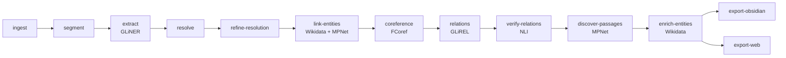

# Architecture

The goal is to connect what a podcast archive talks about across episodes, so a listener can
move from a person, work or concept to every passage where it comes up, and from any
connection back to the transcript and audio behind it. This file explains how the pipeline
and the web app are put together. Setup and commands are in [DEVELOPMENT.md](DEVELOPMENT.md).

## Stages

| Stage | Module | What it adds |
|---|---|---|
| `ingest` | `ingestion.py`, `adapters/` | episodes, transcript text and timed segments for the transcripts listed in a pilot |
| `segment` | `segmentation.py`, `passages.py` | passages: whole sentences packed into short, exact slices of the transcript |
| `extract` | `extraction.py` | named mentions of eight types (Person, Work, School, Concept, Place, Period, Language, Group) |
| `resolve` | `resolution.py` | episode entities and corpus entities, by normalized name and reviewed aliases |
| `refine-resolution` | `identity_refinement.py` | provisional merges of Person entities across episodes (name variants plus context) |
| `link-entities` | `entity_linking.py` | a Wikidata QID per entity, or an explicit "ambiguous" or "NIL" |
| `coreference` | `coreference.py` | pronouns linked to a Person entity when the match is clear |
| `relations` | `relations.py`, `relation_contexts.py` | co-occurrence per passage and typed relations such as *student of* or *influenced by* |
| `verify-relations` | `relation_verification.py` | an NLI check of each relation against its transcript context |
| `discover-passages` | `discovery.py` | related passages in other episodes |
| `enrich-entities` | `enrichment.py` | lifespans and occupations from Wikidata for linked people |
| `export-obsidian` | `vault.py`, `navigation.py`, `vault_discovery.py` | an Obsidian vault |
| `export-web` | `web_export.py` | the JSON files the web app reads |

Coreference, relations, verification, discovery and enrichment are optional. The runner
(`pipeline.py`) checks that each stage can read what the stage before it produced.

## Records and snapshots

Every stage reads one validated parent run and writes a new folder under
`data/prototype1/runs/` (exports go to `export/prototype1/`). A run holds JSONL records and a
`manifest.json` with the parent run, the config and its hash, the code hashes, the model
revisions and the hash of every output file. Nothing is edited in place.

The records form a chain from the source to the graph:

- An **episode** has a **transcript version** (the exact text) and **source segments** with
  start and end times.
- A **passage** is an exact character range of the transcript, made of whole sentences, with
  approximate times taken from the segments. Passages are what the app cites and plays.
- A **mention** is a typed span inside a passage. Mentions of the same thing in one episode
  form an **episode entity**, and episode entities form a **corpus entity** across episodes.
- Links, coreference, relations, verification and discovery results all point back to
  mentions and passages.

Character offsets are zero-based and end-exclusive, counted in Unicode code points, and always
refer to the unchanged transcript text. The Pydantic models in `models.py` and the
`*_models.py` files are the schema.

`spoken-record validate --run <folder>` rebuilds what can be rebuilt without a model (passages,
decisions from saved scores, rankings from saved vectors, the exports) and checks the hashes.
So a run that was edited by hand, or that no longer matches its parent, is rejected.

## Models and decisions

The models are pinned to exact revisions and run offline from the local Hugging Face cache:
GLiNER (`urchade/gliner_medium-v2.1`), FCoref (`biu-nlp/f-coref`), GLiREL
(`jackboyla/glirel-large-v0`), a DeBERTa NLI cross-encoder (`cross-encoder/nli-deberta-v3-base`)
and MPNet (`sentence-transformers/all-mpnet-base-v2`). The interfaces they are used through
are in `backends.py`, and the tests replace them with small offline fakes.

A model only returns spans, clusters, scores or vectors. What gets accepted is decided by
rules in the stage, with thresholds in the config. When the evidence is weak the stage
abstains and records why, instead of guessing:

- the linker marks an entity ambiguous or NIL instead of picking a weak match,
- coreference only links a pronoun to a Person when its cluster points to one entity,
- a relation predicted in both directions is dropped, and the NLI check can withhold it.

None of the scores are calibrated probabilities. Relations and related passages are shown
as suggestions with their evidence, not as facts.

## Running a recipe

A recipe (`config/pipeline.*.json`) lists the stages and their configs. The runner first
plans the whole recipe: it validates every config, hashes every input and refuses output
folders that already exist. Then it runs the stages in order and validates each output
before the next stage starts. Progress goes to `data/prototype1/pipelines/<run-id>/state.json`.
After a failure, `--resume` continues from the last finished stage, but only if the recipe,
inputs and code are unchanged.

A recipe can also start from an existing run (`input_run`), for example to only redo the
export with a new web config.

## The web app

The app in `web/` is a static site (Svelte 5, TypeScript, Vite, Cytoscape.js with a d3-force
layout). It reads the files written by `export-web`: `site`, `episodes`, `passages`,
`entities`, `edges`, `related` and `summary`.

There are two kinds of edges, and the app keeps them apart:

- **relation**: a named, directed relation from GLiREL, marked as NLI-supported or unverified.
- **co_discussed**: two entities mentioned in the same passages, weighted by the number of
  shared passages and by PMI, so specific pairs rank above generic ones. This says nothing
  about how the two are related.

All counts, nodes and edges are computed from the passages the current filters leave
visible (publication years, series, era, lifespan, entity types). The views are Explore
(the graph, either full or focused on one item with one or two steps), Timeline (lifespans
and publication years), Episodes (full transcripts) and Overview. Every passage can be
read in its episode and played from its start time.

## Using it for another podcast

Neither the pipeline nor the app has rules for one particular podcast. A podcast describes
itself through config files:

| What | Where |
|---|---|
| transcript format and folder | profile (`adapter`, `transcripts_dir`) |
| titles, dates, audio links, series or seasons | metadata JSONL, matched by file name (`whisper_json` adapter) |
| corpus audit, quarantine | optional files in the ingest config |
| entity labels for GLiNER | the labels file named in the model config |
| reviewed aliases and QIDs | JSONL files named in the resolution and enrichment configs |
| extra Wikidata description words per type | `extra_type_keywords` in the linking config |
| Obsidian note names | `series_facet`, `series_codes` and the numbering patterns in the vault config |
| app title, groupings, type labels, presets | the `site` block of the web config |

There are two transcript adapters. `hop_whisper` reads History of Philosophy with its own
metadata matching and corpus audit. `whisper_json` reads Whisper JSON from any podcast and
matches metadata by file name. Both use the same parser. `tests/test_other_podcast.py` runs a
made-up podcast with a different layout, no audit and a season facet through every stage to
a valid web export.

The web export writes `site.json` with everything the app needs to know about the archive.
The data has a version number (`schema_version` 2) that the app and `npm run data` check, so
an old export is refused with a message instead of being shown half broken. Entity types are
styled by their position in the configured list, not by name: the first three get the three
main colours, the rest neutral colours, and every type has its own node shape. One build of
the app can hold several archives (`?archive=<id>`).

## Limits

- The entity types and the English models are fixed. Another language or other types need
  new labels or models.
- Transfer to another podcast is tested on synthetic data with model fakes, not yet on a
  real second corpus.
- Identity refinement is a name and context heuristic. Wikidata links never merge local
  entities.
- Passage discovery compares every pair of passages, which is fine for a few dozen episodes
  but will need indexing for the whole archive.
- The runner is sequential and resumes per stage, not per episode.
- The linker's built-in English keyword list still includes "philosopher" and "theologian".
  Removing them would change the linking fingerprint of existing runs.
